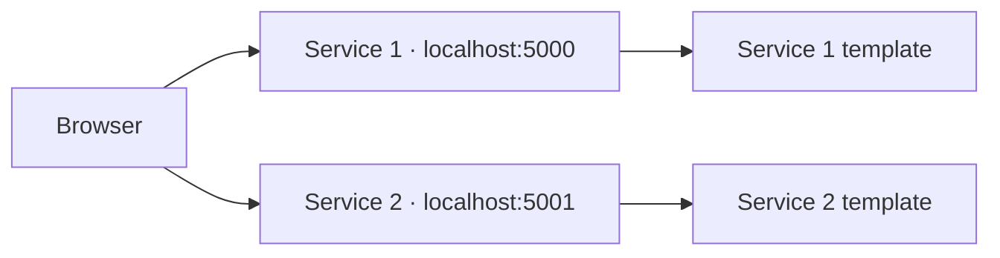

# Flask microservices · project scaffold

Two small Flask services with separate home pages. Despite the repository name, this checkout is a **scaffold**: the CI workflow and setup/test scripts are empty.





## Run service 1

```bash
python3 -m pip install -r microservices/service1/requirements.txt
python3 microservices/service1/app.py
```

Service 2 has its own entry point at [microservices/service2/app.py](microservices/service2/app.py), listening on port 5001. Both entry points enable Flask debug mode for local development.

## Repository map

| File | Purpose |
| --- | --- |
| [microservices/service1](microservices/service1) | First Flask service, templates and tests. |
| [microservices/service2](microservices/service2) | Second Flask service. |
| [scripts](scripts) | Setup, test and deployment script locations. |
| [.github/workflows/ci.yml](.github/workflows/ci.yml) | Empty CI placeholder. |
